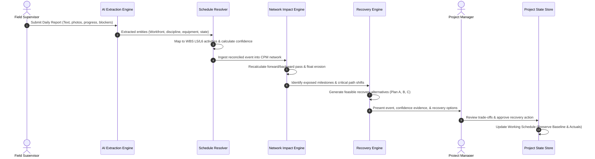

# SYNCRA — Product Requirements & Architectural Specification

**Document Version**: 1.0.0  
**Status**: Draft / Groundwork  
**Target Domain**: Heavy Infrastructure, EPC (Engineering, Procurement, Construction), Capital Facilities  

---

## 1. Vision & Core Value Proposition

In large-scale infrastructure and EPC projects, there is a chronic information chasm between **field reality** (what is actually happening at the workfront each day) and the **project schedule** (the CPM network managed in systems like Primavera P6 or MS Project). 

Field reports (DPRs, subcontractor logs, site photos, foreman notes) are typically unstructured, delayed, and disconnected from schedule WBS codes. As a result, critical-path disruptions, float erosion, and workfront clashes are often identified weeks after they happen—turning minor site variances into multi-million-dollar schedule overruns.

**SYNCRA (Execution Intelligence)** bridges this gap by creating a continuous, closed-loop execution intelligence system:

```
[Field Reality]
  Supervisor Daily Report / Progress / Issues
       │
       ▼
[Intelligence Extraction & Reconciliation]
  AI Entity Extraction ➔ L5/L6 Activity Resolution ➔ Confidence Scoring
       │
       ▼
[Schedule Network Analysis]
  Predecessor/Successor CPM Graph ➔ Float Consumption ➔ Milestone Exposure
       │
       ▼
[Actionable Recovery & Decision Authority]
  Scenario Generation (Resequence / Shift Resources / Absorb)
       │
       ▼
[Manager Approval & Schedule State Update]
  Working Plan Updated ➔ Approved Baseline & Historical Actuals Preserved
```

---

## 2. Core Product Flow (Target System)

The target SYNCRA platform executes the following 8-step lifecycle:



1. **Field Reporting**: Field supervisors input ground reality naturally—daily logs, workfront coordinates, claimed progress, equipment/labor availability, and constraints (e.g., unexpected subsoil obstructions, missing drawings, material stockouts).
2. **AI Entity Extraction**: The system extracts structured parameters: discipline, physical workfront (Grid/Elevation), activity description, labor gangs, equipment deployed, obstruction category, and claimed physical quantity.
3. **L5/L6 Schedule Resolution**: Matches extracted field observations to specific Level 5/Level 6 work packages in the project CPM schedule.
4. **Reconciliation & Confidence Scoring**: Verifies claimed execution against supporting context (crew capacity, spatial clearances, photos, prerequisite inspections). Assigns an explainable verification score (`confidence %`, `evidence count`, `context match`).
5. **Critical Path & Network Impact**: Evaluates the CPM dependency graph (FS, SS, FF relationships, total float, free float). Calculates exact project finish variance and downstream milestone risk.
6. **Recovery Option Generation**: Formulates viable tactical recovery options:
   - *Option A (Resequencing / Fast-tracking)*: Pulling forward independent workfronts.
   - *Option B (Resource Shift / Crashing)*: Reallocating crews/equipment from non-critical activities.
   - *Option C (Acceptance & Buffer Absorption)*: Absorbing delay into existing float with quantified risks.
7. **Manager Decision Review**: Presents actionable trade-offs (schedule gain vs. resource friction vs. risk) to the Project Manager, who holds final approval authority.
8. **Working Schedule Update with Baseline Preservation**: Updates the active working forecast while locking the contractually approved baseline and maintaining an immutable audit trail of field events and manager decisions.

---

## 3. Current Prototype vs. Intended Future System

| Dimension | Current Prototype (`syncra-v1`) | Intended Future System (Target) |
| :--- | :--- | :--- |
| **Activity Scope** | 1 hardcoded activity (`CF-104`, Foundation Excavation) | Dynamic multi-activity construction WBS across Civil, Structural, Piping, Electrical, and Instrumentation |
| **Schedule Network** | Static 2-node mock dependency (`CF-104` ➔ `MF-218`) | Full CPM dependency network (DAG with nodes, leads/lags, total float, critical path recalculation) |
| **Field Input** | Static form with preset defaults | Flexible field logging supporting multiple workfronts, dynamic issues, and varying progress percentages |
| **Activity Resolution** | Hardcoded lookup mapping to `EV-014` | Semantic/rule-based matching engine mapping free-form supervisor input to L4/L5/L6 schedule IDs |
| **Confidence Scoring** | Hardcoded constants (94% confidence, 33 margin) | Multi-factor confidence evaluation (evidence weight, gang productivity bounds, prerequisite completion) |
| **Recovery Modeling** | 3 hardcoded static options for `CF-104` | Algorithmic scenario generator calculating delta float and resource friction per alternative |
| **Code Structure** | Monolithic `App.jsx` (2,439 lines) & `App.css` (6,960 lines) | Modular feature architecture (`features/field`, `features/schedule`, `features/impact`, `features/recovery`) |
| **Data Persistence** | In-memory React state + `BroadcastChannel` | Typed in-memory project store (or mock persistence layer) with schema validation and event history |
| **User Roles** | Basic mock login with navigation case bug | Role-based permissions, distinct persona workflows, and clean navigation routing |

---

## 4. System Boundaries & Explicit Non-Goals

### In Scope (What SYNCRA Is)
- **Execution Intelligence**: Turning field observations into schedule intelligence.
- **CPM Network Awareness**: Calculating float erosion and critical path exposure.
- **Recovery Decision Engine**: Generating tactical options for PM approval.
- **Realistic Multi-Activity Simulation**: A rich, interactive, realistic construction simulation demonstrating real EPC dynamics.
- **Auditability & Baseline Control**: Strict distinction between Approved Baseline, Working Plan, and Historical Actuals.

### Out of Scope (What SYNCRA Is NOT)
- **Not a replacement for Primavera P6/Aconex**: SYNCRA does not aim to be a full-blown Gantt chart editor or document repository. It integrates with / simulates the schedule layer.
- **Not automated auto-scheduling without human approval**: The Project Manager always retains decision authority. The system suggests and analyzes; humans approve.
- **Not ERP / Accounting**: Cost tracking is limited to schedule-related resource friction and high-level budget exposure, not payroll or ledger accounting.

---

## 5. Architectural Direction

### 5.1 Domain Model & Entities

1. **Project**: Top-level entity (e.g. `Alpha Facility, Assam`, EPC Package 2).
2. **Schedule Network (CPM Graph)**:
   - **Activity**: `id`, `wbsCode`, `name`, `discipline`, `level` (L4/L5/L6), `duration`, `earlyStart`, `earlyFinish`, `lateStart`, `lateFinish`, `totalFloat`, `isCritical`, `status` (`Not Started`, `In Progress`, `Blocked`, `Complete`).
   - **Dependency**: `predecessorId`, `successorId`, `type` (`FS`, `SS`, `FF`), `lagDays`.
   - **Milestone**: Key contract milestones (e.g. `M-01: Foundation Complete`, `M-02: Mechanical Ready`, `M-03: Integrated Commissioning`).
3. **Execution Event**:
   - `id`, `timestamp`, `reportedBy`, `rawReportText`, `mappedActivityId`, `workfront`, `claimedProgress`, `blockerType`, `evidenceMetadata`.
4. **Verification & Intelligence Object**:
   - `eventId`, `confidenceScore`, `reconciliationFactors`, `networkExposure` (`consumedFloat`, `exposedSuccessors`, `varianceDays`).
5. **Recovery Scenario**:
   - `scenarioId`, `eventId`, `title`, `mechanism` (`Resequence`, `Crash`, `ScopeShift`), `forecastImpactDays`, `resourceFriction`, `riskLevel`, `status` (`Proposed`, `Approved`, `Rejected`).

### 5.2 Frontend Architecture (Modular Target)

```
src/
├── app/                     # App shell, routing, global providers
├── core/                    # CPM schedule engine, event bus, storage
│   ├── cpmEngine.js         # Forward/backward pass, float calculator
│   ├── eventBus.js          # Cross-tab / BroadcastChannel coordinator
│   └── projectStore.js      # Project state (Baseline, Working, Actuals)
├── data/                    # Simulated project datasets (Alpha Facility WBS)
│   ├── alphaFacilitySchedule.js
│   ├── mockFieldEvents.js
│   └── mockRecoveryTemplates.js
├── features/
│   ├── auth/                # Login, role context, session
│   ├── overview/            # Project health, KPIs, attention list
│   ├── field-reporting/     # Domain Supervisor DPR form, photo upload, validation
│   ├── intelligence/        # Real-time event receiver, confidence breakdown
│   ├── impact/              # Dependency chain visualization, float analysis
│   ├── recovery/            # Recovery option comparison & PM approval
│   └── audit/               # Project state update, baseline preservation log
└── shared/                  # UI components, tokens, layout, badges
```

---

## 6. Success Criteria for the Next Milestones

1. **Realistic EPC Multi-Activity Dataset**: At least 10–15 interconnected activities representing realistic civil, structural, piping, and commissioning sequences with genuine dependency chains and float paths.
2. **Dynamic Schedule Resolution**: Field reports trigger genuine CPM recalculations rather than hardcoded string substitutions.
3. **Preservation of Existing Look & Feel**: Maintain the dark industrial aesthetic, high-contrast typography, and smooth micro-interactions that give SYNCRA its high-value feel.
4. **Clean Codebase Evolution**: Gradually modularize the codebase through planned phases without disrupting working functionality.
