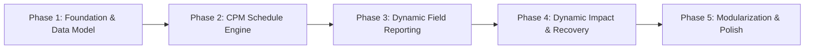

# SYNCRA — Phased Implementation Roadmap

**Current State**: Monolithic Frontend Prototype (`syncra-v1`)  
**Target State**: Realistic End-to-End Multi-Activity EPC Construction Simulation  
**Strategy**: Incremental evolution without breaking working prototype features

---

## Phase Overview

---

## Phase 1: Foundation, Quick Fixes & Realistic EPC Dataset
*Goal: Fix known prototype defects and build a realistic multi-activity construction dataset for "Alpha Facility".*

- [x] **1.1 Fix Role-Based Navigation Bug**:
  - Normalized `userRole` comparison in [`src/App.jsx`](file:///c:/Users/hp/syncra-v1/src/App.jsx) so Project Managers see designated management navigation and supervisors see field execution navigation. Direct 1-click persona logins enabled.
- [x] **1.2 Design Alpha Facility WBS & Schedule Dataset & Topological CPM Engine**:
  - Defined 14 interconnected activities and milestones across Civil, Mechanical, Electrical, and Testing in [`src/data/alphaFacilityData.js`](file:///c:/Users/hp/syncra-v1/src/data/alphaFacilityData.js).
  - Pure CPM engine dynamically derives ES, EF, LS, LF, total float, free float, and critical paths without hardcoded flags.
  - Decoupled side milestone `M-01` (`TF = +9`) from terminal completion constraint `M-03` (`LF = 30`).
- [x] **1.3 Programmatic & UI Verification**:
  - 100% reciprocal topology verified (`validateScheduleTopology()`).
  - Critical paths verified: Baseline `CF-101 → CF-104 → CF-108 → CS-201 → TC-401 → M-03`; Active `CF-104 → CF-108 → CS-201 → TC-401 → M-03`.
  - All non-critical activities mathematically verified with `totalFloat > 0`.
  - `npm run build` exits 0 (644ms); `npx oxlint` exits 0 with 0 errors/warnings.

---

## Phase 2: Closed-Loop Execution Intelligence & CPM Perturbation Engine (High-Fidelity Prototype)
*Goal: Implement the complete end-to-end loop (Signal → Transparent Multi-Factor Gate → Dynamic CPM Perturbation → Float Erosion → Milestone Exposure → Updated Schedule) across 3 interactive scenarios with zero hardcoded impact values.*

- [ ] **2.1 Dynamic CPM Perturbation & Impact Simulation Engine (`scheduleSimulation.js`)**:
  - Implement `simulateSchedulePerturbation(baselineSchedule, disturbance)` taking `{ activityId, delayDays, status, reason }`.
  - Dynamically recalculate forward and backward pass across the 14-node network under variance.
  - Compute dynamic schedule metrics:
    - Delta float for all activities: $\Delta \text{TF}_i = \text{TF}_{\text{perturbed}} - \text{TF}_{\text{baseline}}$
    - Downstream float erosion and affected successor chains.
    - Milestone variance: exact finish dates for `M-01` and `M-03` (e.g. Day 30 ➔ Day 33 dynamically derived).
    - Active critical path shifts and newly critical branches.
- [ ] **2.2 Transparent Multi-Factor Confidence & Automation Gate Model**:
  - Implement deterministic prototype confidence scoring evaluating:
    - Keyword & discipline alignment (`textScore`)
    - Spatial & temporal schedule window alignment (`contextScore`)
    - Crew & evidence log consistency (`evidenceScore`)
    - Hard cross-validation checks (spatial, logic, resources)
  - Derive Candidate Margin ($\text{Score}_1 - \text{Score}_2$).
  - Execute Automation Gate rule:
    $$\text{Auto-Accept} \iff \text{Confidence} \ge 90\% \land \text{Context} \ge 90\% \land \text{Margin} \ge 15\text{ pp} \land \text{No Hard-Check Failures}$$
  - Transparently expose factor breakdowns and rule evaluations in the UI.
- [ ] **2.3 Three Interactive Prototype Scenarios & Lightweight Demo Switcher**:
  - *Scenario 1 (Critical Blockage)*: `CF-104` boulder obstruction (+3 days delay) ➔ Auto-Accepted ➔ critical path slips `M-03` from Day 30 to Day 33.
  - *Scenario 2 (Float Absorption)*: `MP-301` piping delay (+1 day delay) ➔ Auto-Accepted ➔ float absorbed ($\text{TF} \to 0$) without slipping `M-03`.
  - *Scenario 3 (Candidate Ambiguity)*: Ambiguous civil log between `CF-104` and `CF-105` (Margin +4 pp < 15 pp) ➔ Routed to Human Review.
  - Provide lightweight demo scenario switcher on relevant UI views.
- [ ] **2.4 Dynamic UI Data Binding & Verification**:
  - Bind `Execution & Impact`, `Intelligence`, and `Updated Schedule` views to dynamically computed simulation outputs (remove hardcoded Day 33 / float strings).
  - Ensure zero CSS/styling regressions and preserve existing 10-stage supervisor visual pipeline.
  - Verify all 3 scenarios programmatically and through interactive browser walkthrough.

---

## Phase 4: Dynamic Network Impact & Recovery Scenario Generator
*Goal: Replace static recovery options with contextual recovery scenarios driven by the schedule engine.*

- [ ] **4.1 Dynamic Network Impact Visualization**:
  - Render the actual exposed dependency chain (`Blocked Activity ➔ Successor ➔ Milestone`) generated from the CPM engine.
  - Display actual consumed float vs. remaining buffer.
- [ ] **4.2 Context-Aware Recovery Options**:
  - Algorithmic generation of 3 recovery options tailored to the active project state:
    - *Plan A (Resequence)*: Identify non-critical parallel workfronts with high float that can be pulled forward.
    - *Plan B (Resource Shift)*: Identify donor activities with surplus float whose equipment/labor can be reassigned.
    - *Plan C (Accept Variance)*: Compute exact project finish slippage if no action is taken.
- [ ] **4.3 Manager Approval & Working Schedule Update**:
  - Manager approves a chosen plan; system recalculates the working schedule, updates the forecast finish date, and leaves the baseline intact.
- [ ] **4.4 Verification**:
  - Walk through full end-to-end loop: Report issue on an activity ➔ see dynamic impact chain ➔ approve Plan A ➔ verify working forecast recovers while baseline remains preserved.

---

## Phase 5: Architecture Modularization & UI Polish
*Goal: Cleanly extract the monolithic files into reusable feature modules without regressing visuals or features.*

- [ ] **5.1 Modular Component Decomposition**:
  - Safely split `src/App.jsx` into focused feature folders (`features/auth`, `features/overview`, `features/field-reporting`, `features/intelligence`, `features/impact`, `features/recovery`, `features/audit`).
- [ ] **5.2 CSS Organization**:
  - Modularize `src/App.css` into token sheets and feature styles while preserving the dark industrial aesthetic and micro-animations.
- [ ] **5.3 End-to-End Regression & Simulation Walkthrough**:
  - Verify all scenarios (Civil blockage, Piping delay, Calibration gap) flow seamlessly through the complete platform.
