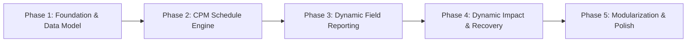

# SYNCRA — Phased Implementation Roadmap

**Current State**: Monolithic Frontend Prototype (`syncra-v1`)  
**Target State**: Realistic End-to-End Multi-Activity EPC Construction Simulation  
**Strategy**: Incremental evolution without breaking working prototype features

---

## Phase Overview

---

## Phase 1: Foundation, Quick Fixes & Realistic EPC Dataset
*Goal: Fix known prototype defects and build a realistic multi-activity construction dataset for "Alpha Facility".*

- [ ] **1.1 Fix Role-Based Navigation Bug**:
  - Normalize `userRole` comparison in [`src/App.jsx`](file:///c:/Users/hp/syncra-v1/src/App.jsx#L84) so Project Managers see their designated navigation buttons instead of supervisor links.
- [ ] **1.2 Design Alpha Facility WBS & Schedule Dataset**:
  - Define 12–16 interconnected activities across Civil, Mechanical, Electrical, and Testing:
    - *Civil*: `CF-101` (Site Prep), `CF-104` (Foundation Excavation), `CF-108` (Foundation Rebar/Pour), `CS-201` (Structural Steel)
    - *Mechanical & Piping*: `MF-218` (Equipment Foundation), `MP-301` (Main Header Piping), `MP-305` (Vessel Placement)
    - *Electrical & Instrumentation*: `EI-310` (Cable Trenching), `EI-312` (Cable Pulling), `IN-320` (Calibration & Readiness)
    - *Milestones*: `M-01` (Civil Handover), `M-02` (Mechanical Completion), `M-03` (Integrated Commissioning)
  - Define dependencies (FS/SS with lag), baseline durations, planned start/finish dates, and float.
- [ ] **1.3 Verification**:
  - Test login with both `manager01` and `domain01` and verify correct navigation states render without console errors.

---

## Phase 2: Lightweight Schedule Engine (CPM & Float Calculation)
*Goal: Move from hardcoded "+3 days / 1 day float" strings to real deterministic schedule calculations.*

- [ ] **2.1 Implement CPM Graph Engine (`cpmEngine.js`)**:
  - Calculate early start (ES), early finish (EF), late start (LS), late finish (LF), total float (TF), and free float (FF).
  - Identify the active Critical Path through topological sort.
- [ ] **2.2 Impact Simulation Functions**:
  - Given an activity delay or blockage (e.g. `CF-104` +3 days), calculate downstream float consumption and milestone variance dynamically.
- [ ] **2.3 Verification**:
  - Unit-verify forward/backward pass with known test DAGs to confirm float and critical path calculations match EPC standard rules.

---

## Phase 3: Dynamic Field Reporting & Activity Resolution
*Goal: Enable field supervisors to report on different activities and simulate the AI extraction/matching pipeline.*

- [ ] **3.1 Multi-Activity Report Submission**:
  - Allow supervisor to select or input reports for different workfronts (e.g., Grid A-14 Civil, Header Piping Area B, Substation Cable Pulling).
- [ ] **3.2 Activity Resolution & Confidence Scoring**:
  - Implement heuristic/semantic matcher that maps raw field report text + discipline to the corresponding WBS Activity ID.
  - Calculate multi-factor confidence metrics (e.g., photo count, crew log consistency, location precision).
- [ ] **3.3 Event Broadcast**:
  - Ensure dynamic event payloads are transmitted via `BroadcastChannel` with full activity metadata.
- [ ] **3.4 Verification**:
  - Submit reports for different activities in Domain Supervisor view; verify Manager view receives and resolves the specific activity dynamically.

---

## Phase 4: Dynamic Network Impact & Recovery Scenario Generator
*Goal: Replace static recovery options with contextual recovery scenarios driven by the schedule engine.*

- [ ] **4.1 Dynamic Network Impact Visualization**:
  - Render the actual exposed dependency chain (`Blocked Activity ➔ Successor ➔ Milestone`) generated from the CPM engine.
  - Display actual consumed float vs. remaining buffer.
- [ ] **4.2 Context-Aware Recovery Options**:
  - Algorithmic generation of 3 recovery options tailored to the active project state:
    - *Plan A (Resequence)*: Identify non-critical parallel workfronts with high float that can be pulled forward.
    - *Plan B (Resource Shift)*: Identify donor activities with surplus float whose equipment/labor can be reassigned.
    - *Plan C (Accept Variance)*: Compute exact project finish slippage if no action is taken.
- [ ] **4.3 Manager Approval & Working Schedule Update**:
  - Manager approves a chosen plan; system recalculates the working schedule, updates the forecast finish date, and leaves the baseline intact.
- [ ] **4.4 Verification**:
  - Walk through full end-to-end loop: Report issue on an activity ➔ see dynamic impact chain ➔ approve Plan A ➔ verify working forecast recovers while baseline remains preserved.

---

## Phase 5: Architecture Modularization & UI Polish
*Goal: Cleanly extract the monolithic files into reusable feature modules without regressing visuals or features.*

- [ ] **5.1 Modular Component Decomposition**:
  - Safely split `src/App.jsx` into focused feature folders (`features/auth`, `features/overview`, `features/field-reporting`, `features/intelligence`, `features/impact`, `features/recovery`, `features/audit`).
- [ ] **5.2 CSS Organization**:
  - Modularize `src/App.css` into token sheets and feature styles while preserving the dark industrial aesthetic and micro-animations.
- [ ] **5.3 End-to-End Regression & Simulation Walkthrough**:
  - Verify all scenarios (Civil blockage, Piping delay, Calibration gap) flow seamlessly through the complete platform.
